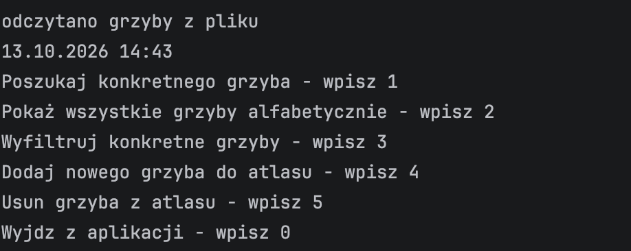
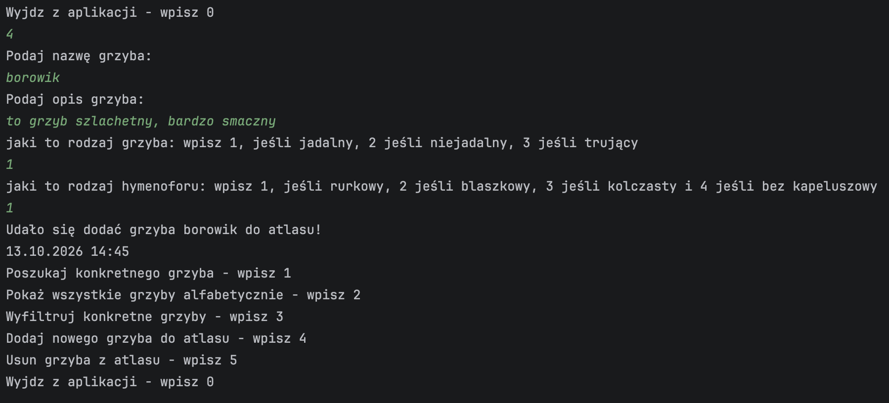
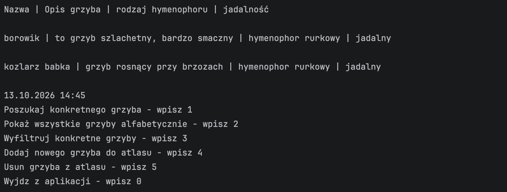

# MushroomAtlas

Console app in Java — a small mushroom atlas you can search, filter and extend.

## What is this

MushroomAtlas is a project I build while going through the JavaStart course (Java basics, part 1). The idea was simple: a mushroom atlas is a natural fit for the things the course teaches — enums (edibility, hymenophore type), classes with validation, collections, streams, `Optional`, exceptions and file operations.

You start the app, see a menu, and can look up a mushroom by name, browse the whole atlas, filter it, or add and remove entries. Everything you add is saved to a file and loaded again on the next start.

All code in this repository was written by me. My design notes and a list of course topics already used in the code are in `src/docs/`.

## App preview

**Main menu**



**Adding a new mushroom**



**All mushrooms in alphabetical order**



## Features

- Search for a mushroom by name (min. 3 characters)
- Show all mushrooms in alphabetical order
- Filter mushrooms by edibility (edible, inedible, poisonous) or by hymenophore type (tubes, gills, teeth, none)
- Add a new mushroom with name, description, edibility and hymenophore type
- Remove a mushroom from the atlas
- Input validation — wrong menu options and invalid data don't crash the app
- Data saved to a file — survives app restarts

## Tech

Java,
Collections (`TreeSet`, `List`) and Streams,
Enums with static factory methods returning `Optional`,
Custom checked and unchecked exceptions,
Object serialization (`ObjectOutputStream` / `ObjectInputStream`),
Date and time API (`LocalDateTime`, `DateTimeFormatter`).

## How to run

Clone the repo, open it in IntelliJ IDEA and run `App.java` (Java 17 or newer).

Or from the terminal:

```
javac -d out $(find src -name "*.java")
java -cp out App
```

## What's next

- More information about each mushroom — season and forest type
- Searching by a fragment of the name
- Marking mushrooms you have already found
- Refactoring repeated code with my own interface and generic methods

---

# MushroomAtlas (PL)

Konsolowa aplikacja w Javie — mały atlas grzybów, który można przeszukiwać, filtrować i rozbudowywać.

## O co chodzi

MushroomAtlas to projekt, który piszę w trakcie kursu JavaStart (Java podstawy, część 1). Pomysł był prosty: atlas grzybów naturalnie pasuje do tego, czego uczy kurs — enumy (jadalność, rodzaj hymenoforu), klasy z walidacją, kolekcje, strumienie, `Optional`, wyjątki i operacje na plikach.

Uruchamiasz aplikację, widzisz menu i możesz wyszukać grzyba po nazwie, przejrzeć cały atlas, przefiltrować go albo dodawać i usuwać grzyby. Wszystko, co dodasz, zapisuje się do pliku i wczytuje przy kolejnym uruchomieniu.

Cały kod w tym repozytorium napisałem samodzielnie. Moje notatki projektowe i lista zagadnień z kursu wykorzystanych w kodzie są w `src/docs/`.

## Prezentacja aplikacji

**Menu główne**


**Dodawanie nowego grzyba**


**Wszystkie grzyby alfabetycznie**


## Co robi aplikacja

- Wyszukiwanie grzyba po nazwie (min. 3 znaki)
- Wyświetlanie wszystkich grzybów alfabetycznie
- Filtrowanie po jadalności (jadalny, niejadalny, trujący) albo po rodzaju hymenoforu (rurkowy, blaszkowy, kolczasty, brak)
- Dodawanie nowego grzyba — nazwa, opis, jadalność i rodzaj hymenoforu
- Usuwanie grzyba z atlasu
- Walidacja danych — błędna opcja w menu czy złe dane nie wywalają aplikacji
- Dane zapisywane do pliku — przeżywają zamknięcie aplikacji

## Technologie

Java,
Kolekcje (`TreeSet`, `List`) i strumienie,
Enumy ze statycznymi metodami fabrykującymi zwracającymi `Optional`,
Własne wyjątki checked i unchecked,
Serializacja obiektów (`ObjectOutputStream` / `ObjectInputStream`),
Daty i czas (`LocalDateTime`, `DateTimeFormatter`).

## Uruchomienie

Sklonuj repo, otwórz w IntelliJ IDEA i uruchom `App.java` (Java 17 lub nowsza).

Albo z terminala:

```
javac -d out $(find src -name "*.java")
java -cp out App
```

## Co dalej

- Więcej informacji o grzybie — pora roku i typ lasu
- Wyszukiwanie po fragmencie nazwy
- Zaznaczanie grzybów, które już znalazłem
- Refaktoryzacja powtarzającego się kodu z użyciem własnego interfejsu i metod generycznych
